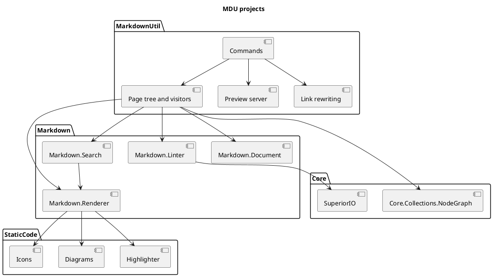

# Components

MDU is one solution, `MarkdownUtils.sln`, with one executable project and several libraries. All projects target .NET 10, and each library has a matching `.Test` project with xUnit tests.

## Overview

| Project | Responsibility | Depends on |
| --- | --- | --- |
| [MarkdownUtil](#markdownutil) | `mdu` command line, page tree, orchestration | all libraries below |
| [Markdown.Document](#markdown.document) | Reads titles, front matter, and links of a page | Markdig, Cap.Core |
| [Markdown.Linter](#markdown.linter) | Validators for titles, link casing, and link targets | SuperiorIO, FluentValidation |
| [Markdown.Renderer](#markdown.renderer) | HTML and PDF rendering | StaticCode.\*, Markdig |
| [Markdown.Search](#markdown.search) | Static search index and search script | Markdown.Renderer |
| [StaticCode.Highlighter](#staticcode.highlighter) | Syntax highlighting for code blocks | — |
| [StaticCode.Diagrams](#staticcode.diagrams) | Mermaid, PlantUML, and context diagrams as SVG | — |
| [StaticCode.Icons](#staticcode.icons) | Embedded icon sets for shortcodes | — |
| [Core.Collections.NodeGraph](#core.collections.nodegraph) | Tree and visitor abstractions | — |
| [SuperiorIO](#superiorio) | Path parsing helpers | — |

## Project dependencies

This diagram shows how the solution projects depend on one another. Select a project to jump to its description.

## MarkdownUtil

The packaged .NET tool `MarkdownUtil` with the command name `mdu`.

- `Program.cs` defines all commands, aliases, and options with `System.CommandLine` and registers the services with `Microsoft.Extensions.DependencyInjection`.
- `Commands/` holds one class per command: `LintCommand`, `FixCommand`, `PrintTreeCommand`, `RenderCommand`, `PdfCommand`, `ServeCommand`, and `PageCommand`.
- `GraphBuilder` and the visitors in `Service/Visitors` build and walk the [page tree](Pipeline.md#page-tree).
- `PreviewServer` serves the rendered site for `mdu serve` and pushes reload events to the browser.
- `MarkdownLinks` finds and rewrites relative Markdown links. `mdu fix`, `mdu page move` (through `PageMover`), and `mdu page links` share it.
- `MarkdownCompatibility` detects MkDocs Material syntax and converts it for `mdu fix`.
- `SiteConfigurationReader` reads `mdu.yml`, `GitLastModified` reads page dates from git, and `LintResultRenderer` prints lint results as text, JSON, or GitHub annotations.

## Markdown.Document

Reads what MDU needs to know about a page without rendering it: the YAML front matter, the level-one title, and the links. Links include images, reference definitions, and node links in Mermaid, context, and PlantUML diagrams, so the linter checks them all.

## Markdown.Linter

Contains the rule codes `MDU001`–`MDU018` and the validators that need only one page and the file system:

| Validator | Rule |
| --- | --- |
| `Rule2Validator` | `MDU002` DirectoryTitleMatch |
| `Rule3Validator` | `MDU003` LinkCasing |
| `Rule4Validator` | `MDU004` LocalLinkExists |

The validators use FluentValidation. Rules that need the whole page tree, such as duplicate pages, navigation placement, and MkDocs migration issues, are checked by the `LinterVisitor` in MarkdownUtil. See the [rules reference](../Usage/lint/Rules.md) for every rule.

## Markdown.Renderer

Turns Markdown into pages. `HtmlRenderer` holds the Markdig pipeline and the embedded HTML template, stylesheet, and scripts; `PdfRenderer` lays out the same HTML on A4 pages. [Rendering](Rendering.md) describes both in detail.

## Markdown.Search

`SearchIndexBuilder` splits every page into sections at its headings and writes their plain text to `search-index.json`. `SearchClientAsset` writes `js/search.js`, which searches that index in the browser and links to the matching section.

## StaticCode.Highlighter

A small lexer with lightweight grammars for C#, Swift, YAML, shell, and Markdown. `HtmlFormatter` wraps the tokens in `span` elements whose classes the stylesheet colors. Other languages stay readable as plain code.

## StaticCode.Diagrams

Parses diagram sources and writes SVG. `DiagramRenderer.TryRenderSvg` handles Mermaid flowcharts, sequence and class diagrams, PlantUML component diagrams, and MDU's own context diagrams.

- Flowcharts use their own layered (Sugiyama) layout in `Layout/LayeredLayout.cs`.
- PlantUML containers are laid out from the inside out, so nested packages size to their content.
- Context diagrams place the central system in the middle and its neighbors around it.
- The SVG carries only CSS classes and no colors; the site stylesheet themes it for light and dark mode.

When a source uses unsupported syntax, `TryRenderSvg` returns `false` and the block stays a code block.

## StaticCode.Icons

Embeds the icon sets behind the [icon shortcodes](../Features/Icons-and-Emojis.md) as gzip-compressed, reduced Iconify JSON. `IconCatalog` resolves a shortcode such as `:material-rocket:` to its SVG. The script `update-icon-sets.sh` regenerates the sets with npm, and `dashboard-icons.mjs` sanitizes the colored Dashboard Icons with SVGO.

## Core.Collections.NodeGraph

A general tree: every node has an optional parent and any number of children. `IVisitor<T>` and the `Visit` extension walk the tree depth-first or breadth-first. Each command is a set of visitors over the page tree.

## SuperiorIO

Parses paths into elements so the linter can compare a link target with the file-system entry, including its casing.

## Third-party libraries

| Library | Used for | Project |
| --- | --- | --- |
| [Markdig](https://github.com/xoofx/markdig) | CommonMark parsing and HTML output | Document, Renderer, Search |
| [System.CommandLine](https://github.com/dotnet/command-line-api) | Commands, options, and help | MarkdownUtil |
| [Microsoft.Extensions.DependencyInjection](https://learn.microsoft.com/dotnet/core/extensions/dependency-injection) | Service registration | MarkdownUtil |
| [YamlDotNet](https://github.com/aaubry/YamlDotNet) | Front matter, `mdu.yml`, and `hero` options | MarkdownUtil, Renderer |
| [FluentValidation](https://github.com/FluentValidation/FluentValidation) | Lint validators | Linter |
| [CSharpMath](https://github.com/verybadcat/CSharpMath) and [VectSharp](https://github.com/arklumpus/VectSharp) | Math formulas as SVG | Renderer |
| Cap.Core | Parser and text helpers | MarkdownUtil, Document, Highlighter |

> [!NOTE]
> The rendered site loads none of these libraries; they run only while MDU works. The notices for the bundled icon sets and the math renderer ship in `THIRD-PARTY-NOTICES.md` inside the package.
