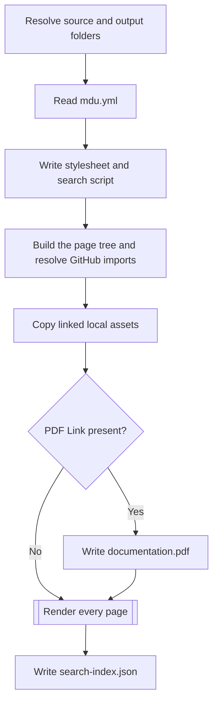
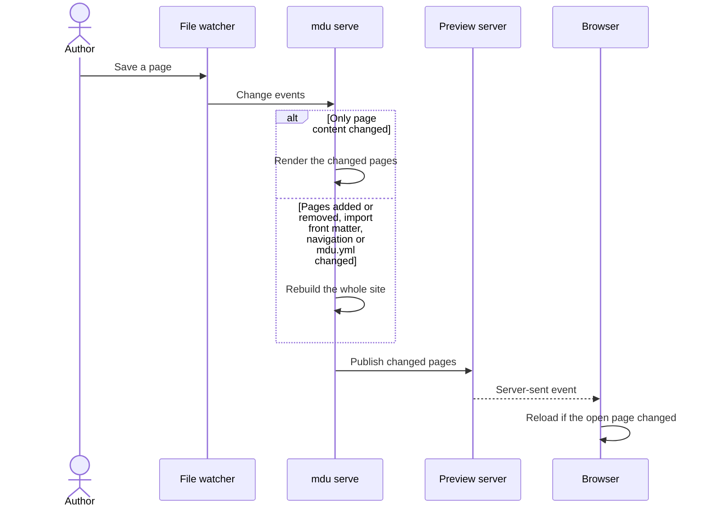

# Processing Pipeline

Most commands follow the same pattern: find the Markdown files, build a page tree, and walk it with one or more visitors. The visitors decide what a command does.

## Page tree

`GraphBuilder` turns the documentation folder into a tree of `MarkdownFile` nodes:

1. It lists the files that match the search pattern, `*.md` by default, folder by folder.
2. A folder's `README.md`, or else its `index.md`, becomes the parent of the other pages in that folder and of the pages in its subfolders.
3. A folder without such a page adds its pages to the nearest parent above it.
4. `DataPreparationVisitor` reads each page's level-one heading and front matter: `title`, `description`, `icon`, `openapi`, `mdu.import.source`, and the `navigation.*` settings.
5. `GraphBuilder` resolves GitHub imports and mounts each imported folder's page tree at the import page's position. Each imported page keeps its repository source path and its site-relative path.

```text
docs/
├── README.md          → root page
├── Setup/
│   ├── README.md      → child of README.md, parent of the pages below
│   ├── DotNet-Tool-Installation.md
│   └── Portable-Installation.md
└── Usage/
    ├── README.md      → child of README.md, parent of the pages below
    ├── render.md
    └── lint/
        ├── README.md  → child of Usage/README.md
        └── Rules.md
```

The tree is the single source for the sidebar, the top navigation, breadcrumbs, previous and next links, and the page order of the PDF. `mdu tree` prints it.

## Commands and visitors

| Command | Walks the tree with | Result |
| --- | --- | --- |
| `tree` | `PrintTreeVisitor` | Indented page titles |
| `lint` | `LinterVisitor`, then `LintResultRenderer` | Diagnostics as text, JSON, or GitHub annotations |
| `fix` | `LinterVisitor`, then `MarkdownCompatibility` and `MarkdownLinks` | Converted syntax, moved pages, and updated links |
| `render` | `LocalAssetsCopy`, `PdfCommand`, `MarkdigVisitor` | Static site and, when a PDF Link is present, `documentation.pdf` |
| `serve` | Same as `render`, then a file watcher | Preview site and a refreshed PDF when a PDF Link is present |
| `pdf` | The tree in navigation order, then `PdfRenderer` | One PDF file |

`mdu page move` and `mdu page links` need no page tree. They read every Markdown file below the documentation folder with `MarkdownLinks`, so they also see pages that are hidden from navigation.

## Rendering a site

`mdu render` runs these steps once and exits. Click a step to read more.



For each page, `MarkdigVisitor`:

- removes the front matter, appends any generated OpenAPI reference, and adds the page text, split at its headings, to the search index;
- collects the navigation, top navigation, breadcrumbs, and last-changed date from the tree and git;
- lets `HtmlRenderer` write the page to a temporary file and then moves it into place, so a browser never reads a half-written page;
- writes `README.md` as `index.html`, and adds a small redirect page so that `Setup/` also reaches `Setup.html`.

Assets are found through the links on each page. Only linked local files are copied, with their relative paths unchanged; external URLs stay where they are.

## Live preview

`mdu serve` renders the site once, starts a local HTTP server, and watches the source folder. Changes are collected for a short moment and handled as one batch:



`serve` remembers which assets each page links to. When an image changes, it copies the new file and reloads only the pages that show it. Changes to an OpenAPI specification rebuild the site so its generated reference stays current. A changed import page triggers a rebuild and resolves its GitHub URL again; restarting `serve` picks up remote branch changes when no local import page changed. Files that disappear from the site are removed from the output folder.

When Markdown content changes, `serve` refreshes `documentation.pdf` if a PDF Link remains in the project. Adding the first link creates the file; removing the last link deletes it.

## PDF export

`mdu pdf` builds the same page tree and orders it like the navigation. `PdfRenderer` renders every page with the HTML pipeline, lays out the resulting elements on A4 pages, and writes the PDF file itself. A folder export adds a title page and a linked table of contents. See [Rendering](Rendering.md#pdf-output) for the details.

## Linting and fixing

`LinterVisitor` checks each page in the tree. It reads the page's links with `Markdown.Document` and runs the [validators](Components.md#markdown.linter) for titles, link casing, and link targets. It checks rules that depend on the tree itself, such as duplicate pages, section pages, and navigation placement. The results go to a receiver, which `LintResultRenderer` then prints in the chosen format.

`mdu fix` runs the same linter, then applies what it can fix: it converts MkDocs Material syntax, renames `index.md` pages, creates missing section pages, and moves pages flagged by `MDU006`. Whenever a page moves, `MarkdownLinks` rewrites the links to it and the relative links inside it.
