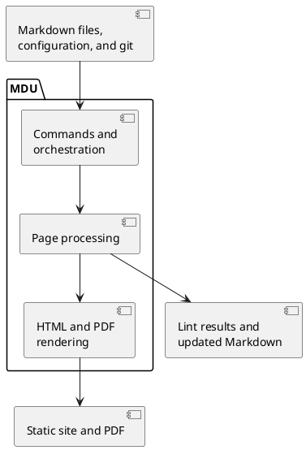

# Architecture

MDU is a single .NET tool. It reads a folder of ordinary Markdown files, builds a page tree from the folder structure, and then lints, renders, or rewrites those pages. Everything a published site needs is produced at build time, so the result is a folder of static files.

## Design principles

| Principle | What it means |
| --- | --- |
| **Portable sources** | Pages stay plain Markdown that reads well on GitHub. MDU features use code blocks, shortcodes, or front matter that degrade to readable text elsewhere. |
| **Static output** | Diagrams, math, icons, and syntax highlighting become HTML and SVG while rendering. The site needs no server, CDN, or client-side renderer. |
| **Few dependencies** | One `dotnet tool`: no Node.js, Python, Java, or browser engine. MDU writes PDF files itself. |
| **Scriptable CLI** | Commands print plain text and return exit codes; `mdu lint` also writes JSON and GitHub annotations. |

## System context

MDU sits between the documentation author and the published site. Click a node to read more.

```context
accTitle: MDU system context
Mdu[MDU<br>mdu command]
actor Author as Documentation author
Author -. lints, previews, renders .-> Mdu
Source[Markdown pages<br>and assets] --> Mdu
Config[mdu.yml<br>site settings] --> Mdu
Git[Git history] --> Mdu
Mdu --> Site[Static HTML site]
Mdu --> Pdf[PDF document]
Ci[CI pipeline<br>GitHub Actions, GitLab CI] -- runs --> Mdu
click Source href "../Features/README.md"
click Config href "../Usage/render.md#site-configuration"
click Git href "../Features/Navigation.md#page-footer"
click Site href "Rendering.md"
click Pdf href "../Usage/pdf.md"
click Ci href "../Publish/README.md"
```

- **Inputs** are the Markdown pages with their linked images and files, an optional `mdu.yml`, and the git history, which provides the *last changed* date of each page.
- **Outputs** are a static site that any web server can host, a single PDF document, lint reports, or rewritten Markdown files after `mdu fix` and `mdu page move`.

## Building blocks

MDU has three main parts. Select a block to open its detailed view.



## In this section

- [Components](Components.md) - What each project does and which libraries it uses
- [Processing Pipeline](Pipeline.md) - How commands build the page tree, render a site, and refresh the live preview
- [Rendering](Rendering.md) - How a Markdown page becomes an HTML page with diagrams, math, and icons
