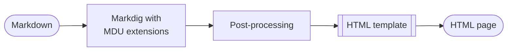
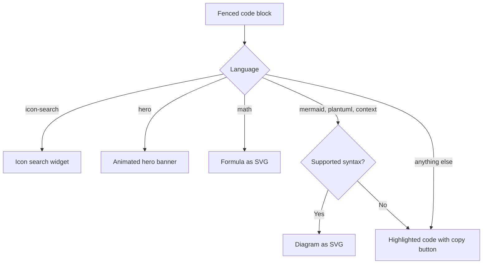

# Rendering

`Markdown.Renderer` turns the Markdown of one page into a complete HTML page, or into PDF content. The page tree supplies everything around the content, such as navigation and breadcrumbs; the renderer supplies the content itself and the page frame.

Pages with an `openapi` front matter entry have a generated API reference appended to their Markdown before rendering. `OpenApiMarkdownRenderer` reads the local JSON or YAML file, then the normal HTML and PDF renderers process the combined content. See the [OpenAPI feature](../Features/OpenAPI.md) for its usage and supported content.

## From Markdown to HTML



1. **Parse.** Markdig parses the page with the extensions listed below.
2. **Rewrite links.** Relative links to `.md` files point to the rendered `.html` pages; `README.md` becomes `index.html`. Anchors and query strings are kept.
3. **Render.** Markdig writes the HTML. Code blocks go through MDU's own [code block renderer](#code-blocks).
4. **Post-process.** Standalone video links become consent placeholders, a full-width hero moves above the page layout, headings get permalinks, and the *On this page* list is collected.
5. **Fill the template.** The embedded `main.html` contains placeholders such as `%%MARKDOWN%%`, `%%NAVIGATION_ITEMS%%`, and `%%PAGE_BREADCRUMBS%%`. `HtmlRenderer` replaces them with HTML-encoded values; there is no separate template engine.

## Markdig extensions

| Extension | Adds |
| --- | --- |
| Markdig advanced extensions | Pipe and grid tables, footnotes, task lists, emphasis extras, heading IDs, automatic links, and attribute lists |
| `ScrollableTableExtension` | Wraps wide tables in a horizontally scrollable container |
| `RenderedMathExtension` | [Math](../Features/Math.md) as inline SVG |
| `GitHubAlertExtension` | [Callouts](../Features/Callouts.md) with GitHub's alert syntax |
| `ShortcodeExtension` | [Icons and emojis](../Features/Icons-and-Emojis.md) from shortcodes |
| `KeysExtension` | [Keyboard keys](../Features/Keyboard-Keys/README.md) such as ++ctrl+alt+del++ |
| `HighlighterExtension` | The code block renderer below |

## Code blocks

Every fenced code block passes through one renderer, which picks the output by the block's language:



Because a diagram that cannot be rendered stays a code block, a page never breaks on unknown syntax. `mdu lint` reports unsupported Mermaid syntax as `MDU010`.

## Page assets

Every page links the shared `css/main.css`. Everything else is added only to the pages that need it:

| Asset | Added when |
| --- | --- |
| `js/search.js` and `search-index.json` | Always; the search runs in the browser without a service |
| Icon search script and index in `js/` | A page contains an `icon-search` block |
| Hero styles and WebGL scene, inline | A page contains a `hero` block |
| Media consent script, inline | A page contains a standalone YouTube or Vimeo link |
| Logos and favicons from `mdu.yml` | They are configured |

A rendered site looks like this:

```text
site/
├── index.html
├── search-index.json
├── css/
│   └── main.css
├── js/
│   └── search.js
├── assets/
│   └── logo.svg
└── Usage/
    ├── index.html
    └── render.html
```

## In the browser

The generated pages work without a build step or framework. Small inline scripts add:

- light and dark themes, with an automatic mode that follows the operating system;
- the collapsible sidebar, top navigation tabs, and a drawer on narrow screens;
- client-side search with links to the matching section and highlighted hits;
- copy buttons for code blocks, image lightboxes, and footnote previews;
- the consent dialog for embedded videos.

Theme colors from `mdu.yml` become CSS custom properties. Secondary colors, lines, and hover backgrounds are mixed from them in CSS, so a custom palette stays consistent.

## PDF output

`PdfRenderer` reuses the HTML pipeline for `mdu pdf` and for the `documentation.pdf` generated by `mdu render` and `mdu serve` when the project contains a PDF Link. It renders every page to an HTML fragment, reads that fragment as XML, and lays out its blocks on A4 pages. Diagrams and formulas are drawn from their SVG paths. The writer uses the fonts built into every PDF reader, so it embeds no font files; emoji shortcodes therefore stay text. Links between included pages become internal PDF links.
