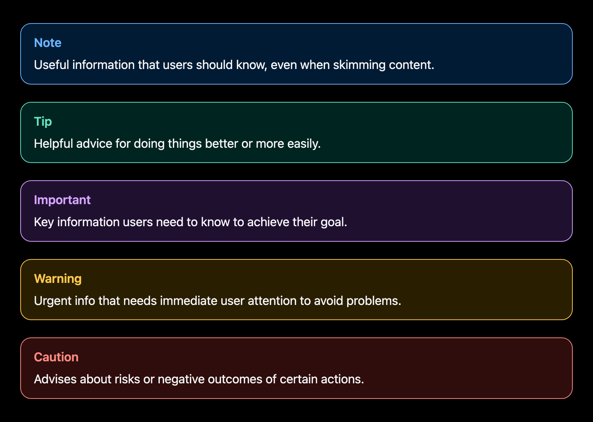
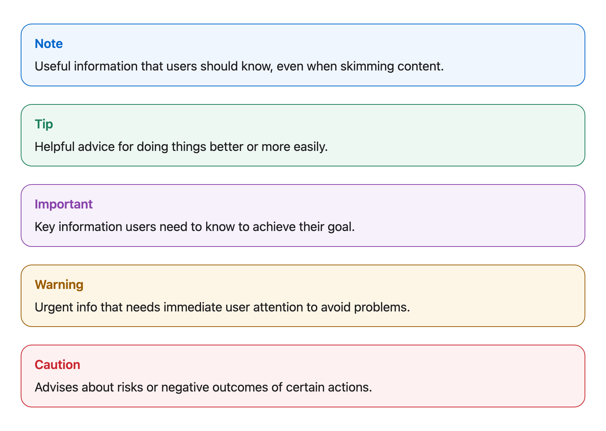

# Admonitions

## Overview

Admonitions, also called alerts or callouts, highlight information that readers should not miss. MarkdownUtil uses the same syntax as [GitHub alerts](https://docs.github.com/en/get-started/writing-on-github/getting-started-with-writing-and-formatting-on-github/basic-writing-and-formatting-syntax#alerts), so your files look right on GitHub and in the rendered site. The rendered style follows Apple's developer documentation: a rounded box with a colored border, a tinted background, and a bold colored title.





## Syntax

Start a block quote with the alert type on its own line, then write the content on the following lines:

```markdown
> [!NOTE]
> Useful information that users should know, even when skimming content.
```

MarkdownUtil supports all five GitHub alert types:

```markdown
> [!NOTE]
> Useful information that users should know, even when skimming content.

> [!TIP]
> Helpful advice for doing things better or more easily.

> [!IMPORTANT]
> Key information users need to know to achieve their goal.

> [!WARNING]
> Urgent info that needs immediate user attention to avoid problems.

> [!CAUTION]
> Advises about risks or negative outcomes of certain actions.
```

## Examples

The examples below are rendered from the Markdown above.

> [!NOTE]
> Useful information that users should know, even when skimming content.

> [!TIP]
> Helpful advice for doing things better or more easily.

> [!IMPORTANT]
> Key information users need to know to achieve their goal.

> [!WARNING]
> Urgent info that needs immediate user attention to avoid problems.

> [!CAUTION]
> Advises about risks or negative outcomes of certain actions.

An admonition can contain any Markdown, such as several paragraphs, lists, links, and code:

> [!TIP]
> Preview your documentation while you write:
>
> ```shell
> mdu serve
> ```
>
> The [Usage](../../Usage/README.md) section describes all commands.

## Rules

MarkdownUtil follows the same rules as GitHub:

- The marker must be the first line of a block quote and stand alone on that line. Text after the marker, such as `> [!NOTE] Text`, renders a regular block quote.
- The type is not case-sensitive: `[!NOTE]`, `[!Note]`, and `[!note]` are equivalent.
- Only `NOTE`, `TIP`, `IMPORTANT`, `WARNING`, and `CAUTION` are alert types. Any other type renders a regular block quote.
- The marker must be followed by content. A block quote that contains only the marker remains a regular block quote.
- Admonitions cannot be nested inside lists or other block quotes.

## Styling

MarkdownUtil uses [Markdig's alert blocks](https://xoofx.github.io/markdig/docs/extensions/alert-blocks/) and renders the same HTML structure as GitHub: a `div` with the classes `markdown-alert` and `markdown-alert-<type>`, for example `markdown-alert-tip`, followed by a `markdown-alert-title` paragraph. The title is shown without an icon, and the colors adapt to the light and dark themes.
