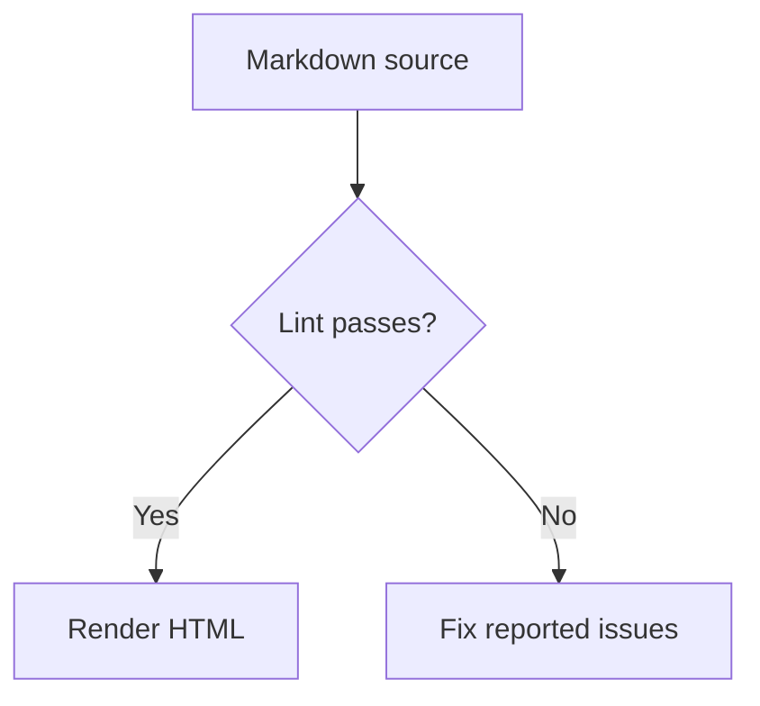
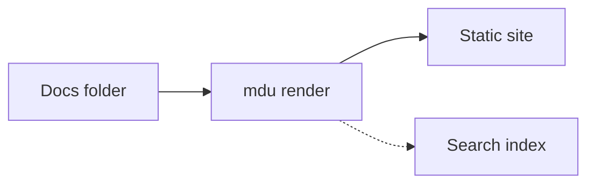
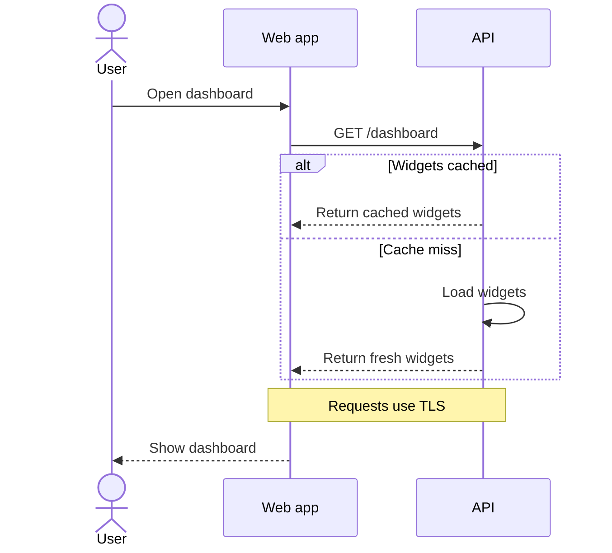
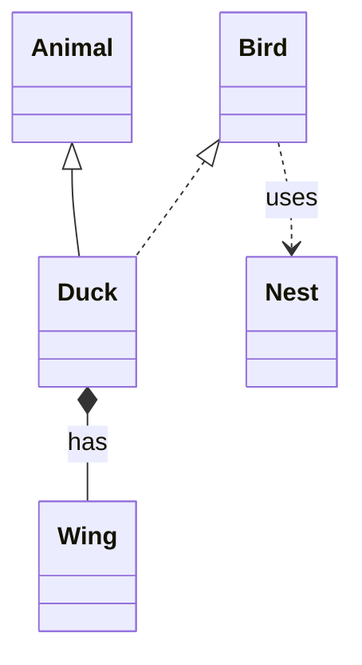
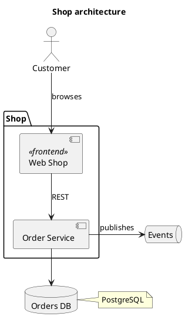
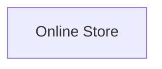
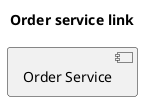

# Diagrams

Write diagrams as text; MDU turns supported code blocks into static SVG in the rendered page.

- Rendered as static SVG without JavaScript
- Works offline
- Follows the light or dark theme
- Keeps diagram sources portable Markdown

> [!NOTE]
> MDU uses its own renderers for subsets of Mermaid and PlantUML. The output can differ from those tools, and unsupported syntax is not rendered as a diagram.

| Type | Use for | Code block | Also renders with |
| --- | --- | --- | --- |
| [Flowchart](#flowcharts) | Processes and decisions | `mermaid` | Mermaid, GitHub |
| [Sequence](#sequence-diagrams) | Interactions over time | `mermaid` | Mermaid, GitHub |
| [Class](#class-diagrams) | Types and relationships | `mermaid` | Mermaid, GitHub |
| [Component](#component-diagrams) | Architecture building blocks | `plantuml` | PlantUML |
| [Context](#context-diagrams) | A system in its environment | `context` | MDU only |

## Flowcharts

Use a `mermaid` code block for processes and decisions.

~~~markdown title="Markdown"

~~~


Use `LR` for a diagram that flows from left to right:

~~~markdown title="Markdown"

~~~


### Flowchart syntax

| Element | Syntax | Meaning |
| --- | --- | --- |
| Header and direction | `flowchart TD`, `graph LR` | `TD`/`TB` top to bottom, `BT` bottom to top, `LR` left to right, `RL` right to left |
| Node shapes | `A[Text]`, `A(Text)`, `A([Text])`, `A((Text))`, `A{Text}`, `A[[Text]]`, `A{{Text}}` | Rectangle, rounded rectangle, stadium, circle, diamond, subroutine, and hexagon |
| Namespaced IDs | `target:App` | Adds one namespace prefix to a node ID |
| Labels | `A["Text [with brackets]"]`, `A[First<br>Second]` | Double quotes allow brackets in labels; `<br>` starts a new line |
| Solid links | `-->`, `---`, `<-->`, `--o`, `--x` | Arrow, plain line, arrows at both ends, circle end, cross end |
| Dotted links | `-.->`, `-.-` | Dotted arrow or plain dotted line |
| Thick links | `==>`, `===` | Thick arrow or plain thick line |
| Link labels | `A -->|Yes| B` or `A -- Yes --> B` | Adds explicit text to a link |
| Chains and groups | `A --> B --> C`, `A & B --> C` | Chains links or connects multiple source nodes to one target |
| Subgraphs | `subgraph Services ["Services"]` … `end` | Groups nodes within the flowchart |
| Accessible title | `accTitle: Text` | Sets the accessible title |
| Comments | `%% comment` | Ignores the line |

Longer links made by adding dashes, dots, or equals signs span more layout ranks. MDU does not support every Mermaid flowchart shape or statement. Node links are covered under [Clickable nodes](#clickable-nodes).

## Sequence diagrams

Use a `mermaid` code block to show messages between participants over time.

~~~markdown title="Markdown"

~~~


### Sequence syntax

| Element | Syntax | Meaning |
| --- | --- | --- |
| Participants | `participant A`, `participant A as Label`, `actor A`, `actor A as Label` | Declares a participant or stick-figure actor, optionally with a display label |
| Messages | `->`, `-->`, `->>`, `-->>`, `-x`, `--x`, `-)`, `--)`, `<<->>`, `<<-->>` | `-` draws a solid line and `--` a dotted line; `>>` adds an arrowhead, `x` a cross end, `)` an open end, and `<<…>>` arrowheads at both ends |
| Line breaks | `A->>B: First<br>second`, `Note over A: First<br>second` | Starts a new line in a message or note |
| Activations | `activate A`, `deactivate A`; `A->>+B: Text`, `A->>-B: Text` | Starts or ends an activation; `+` activates the target and `-` deactivates the source |
| Notes | `Note left of A: Text`, `Note right of A: Text`, `Note over A,B: Text` | Places a note beside one participant or over one or two |
| Blocks | `loop`, `alt`/`else`, `opt`, `par`/`and`, `critical`/`option`, `break`, `rect` … `end` | Groups messages in a control block |
| Numbering | `autonumber`, `autonumber 10 5`, `autonumber off` | Numbers messages, optionally setting the start and step, or turns numbering off |
| Titles | `title Text`, `accTitle: Text` | Sets the visible title or accessible title |
| Comments | `%% comment` | Ignores the line |

Blocks end with `end`. `rect` draws a highlighted area, but its color argument is ignored. `box`, `create`, `destroy`, and participant links are not supported.

## Class diagrams

Use `classDiagram` or `classDiagram-v2` in a `mermaid` code block to show types and their relationships.

~~~markdown title="Markdown"

~~~


### Class syntax

| Element | Syntax | Meaning |
| --- | --- | --- |
| Header | `classDiagram`, `classDiagram-v2` | Starts a class diagram |
| Class | `class Name` | Declares a class; a relationship also introduces referenced classes |
| Generalization | `Base <|-- Child`, `Child --|> Base` | Hollow triangle at the superclass, which is placed above the subclass |
| Realization | `Interface <|.. Implementation`, `Implementation ..|> Interface` | Dotted hollow triangle at the interface, which is placed above the implementing class |
| Composition | `Whole *-- Part`, `Part --* Whole` | Filled diamond at the whole, which is placed above the part |
| Aggregation | `Whole o-- Part`, `Part --o Whole` | Hollow diamond at the whole, which is placed above the part |
| Dependency | `A ..> B`, `B <.. A` | Dotted arrow |
| Association | `A -- B`, `A --> B`, `A <-- B`, `A .. B` | Solid or dotted association, with an optional arrow |
| Relationship labels | `A *-- B : has` | Shows only explicit labels; MDU adds no default labels |

Class declarations, relationships, and optional relationship labels are supported. Attributes, methods, aliases, and display labels are not. Class diagrams have no title syntax.

## Component diagrams

Use a `plantuml` code block for component diagrams. MDU renders a subset of PlantUML component syntax.

~~~markdown title="Markdown"

~~~


### Component syntax

| Element | Syntax | Meaning |
| --- | --- | --- |
| Frame | `@startuml` … `@enduml` | Optional delimiters for the diagram source |
| Elements | `[Name]`, `component Name`, `interface Name`, `actor Name`, `database Name`, `node Name`, `cloud Name`, `folder Name`, `frame Name`, `package Name`, `rectangle Name`, `card Name`, `artifact Name`, `file Name`, `queue Name`, `storage Name` | Declares components, interfaces, actors, or other supported elements |
| Interfaces | `() "Name"` | Declares an interface with a display name |
| Aliases | `[Name] as Alias`, `component "Name" as Alias` | Assigns an ID to an element with a display name |
| Containers | `package "Shop" {` … `}`; also `node`, `folder`, `frame`, `cloud`, `database`, `rectangle`, and `component` | Groups elements; containers may be nested |
| Stereotypes | `<<name>>` after an element | Adds a stereotype |
| Link lines | `-`, `--`, `..`, `==`, optionally with `>` or `<` | Solid, dotted, or bold line, with an optional arrow end |
| Link direction and length | `->`, `-->`, `-up->`, `-down->`, `-left->`, `-right->` | One dash defaults right, two or more default down; extra dashes lengthen the link and a direction word selects its direction |
| Link labels | `A --> B : Text` | Adds explicit text to a link |
| Link styles | `A -[hidden]-> B`, `A -[dashed]-> B`, `A -[bold]-> B` | Hides a link or draws it dotted or bold |
| Triangle ends | `A ..|> B`, `A <|-- B` | Adds a triangle end to the link |
| Node links | `url of ID is [[details.md]]` | Links an element; use its alias for `ID` when declared |
| Notes | `note right of A : Text`; `note right of A` … `end note`; `note "Text" as N` … `end note` | Adds an attached or standalone note |
| Line breaks | `\n` in labels or notes | Starts a new line |
| Layout | `left to right direction`, `top to bottom direction` | Sets the overall layout direction |
| Title | `title Text` | Adds a diagram title and accessible name |
| Comments | `' comment`, `/' comment '/` | Ignores line comments and block comments |

`hide`, `show`, `scale`, `!theme`, `!pragma`, `allowmixing`, and `allow_mixing` are ignored. Other PlantUML diagram types, including sequence and class diagrams, remain code blocks.

## Context diagrams

Use an MDU `context` code block to show a system and the people and systems connected to it.

~~~markdown title="Markdown"
```context
accTitle: Online store context
Store[Online Store]
Store <--> IdP[Identity Provider<br>OIDC]
Store <--> Payment[Payment Provider]
Store --> Shipping[Shipping Service]
Store <--> Inventory[Inventory and Order System]
Store --> Email[Email Service]
actor Customer
actor Manager as Store Manager
actor Warehouse as Warehouse Team
Customer -. Browses and orders .-> Store
Manager -. Manages catalog .-> Store
Warehouse -. Handles shipments .-> Store
```
~~~

```context
accTitle: Online store context
Store[Online Store]
Store <--> IdP[Identity Provider<br>OIDC]
Store <--> Payment[Payment Provider]
Store --> Shipping[Shipping Service]
Store <--> Inventory[Inventory and Order System]
Store --> Email[Email Service]
actor Customer
actor Manager as Store Manager
actor Warehouse as Warehouse Team
Customer -. Browses and orders .-> Store
Manager -. Manages catalog .-> Store
Warehouse -. Handles shipments .-> Store
```

### Context syntax

| Element | Syntax | Meaning |
| --- | --- | --- |
| Header | None | A context block has no header line |
| Systems | Flowchart node shapes such as `A[Text]`, `A(Text)`, `A([Text])`, `A((Text))`, and `A{Text}` | Uses the same shapes as a flowchart |
| People | `actor A` or `actor A as Label` | Adds a stick-figure actor |
| Links | Flowchart links such as `-->`, `<-->`, `-.->`, `==>`, and `A -- Text --> B` | Uses the same lines, ends, and labels as a flowchart |
| Titles | `accTitle: System context` | Sets the accessible title |
| Comments | `%% comment` | Ignores the line |

The center is the system every link touches. If more than one system qualifies, the first one in the source is the center. Other systems and actors are evenly spaced clockwise from the top in the order they first appear. Reorder their source lines to change their positions. Subgraphs are not supported.

## Clickable nodes

A Mermaid `click` statement links a flowchart or context node; PlantUML's `url of` statement links a component. The linked node is recognizable and can be opened from the rendered HTML.

| Diagram | Syntax | Meaning |
| --- | --- | --- |
| Flowchart | `click A href "details.md"` | Links node `A` to a destination |
| Context | `click A href "details.md"` | Links node `A` to a destination |
| Component | `url of ID is [[details.md]]` | Links element `ID` to a destination |

Relative `.md` destinations become `.html` in the rendered site. `mdu lint` checks destination casing and that the page exists. External URLs can also be used for node links; the optional Mermaid tooltip is ignored.

**Flowchart**

~~~markdown title="Markdown"

~~~


**Context**

~~~markdown title="Markdown"
```context
accTitle: Inventory link
Store[Online Store] --> Inventory[Inventory]
click Inventory href "inventory.md"
```
~~~

```context
accTitle: Inventory link
Store[Online Store] --> Inventory[Inventory]
click Inventory href "inventory.md"
```

**Component**

~~~markdown title="Markdown"

~~~


## Styling and themes

Mermaid `style`, `classDef`, `class`, and `linkStyle` statements, PlantUML `skinparam` and explicit colors are ignored. The page stylesheet sets diagram colors so they follow the light or dark theme.

## Unsupported syntax

> [!TIP]
> MDU supports only a subset of Mermaid and PlantUML. If a Mermaid block uses unsupported syntax, it stays a code block and `mdu lint` reports `MDU010`. Unsupported PlantUML and context blocks also remain code when rendered.
