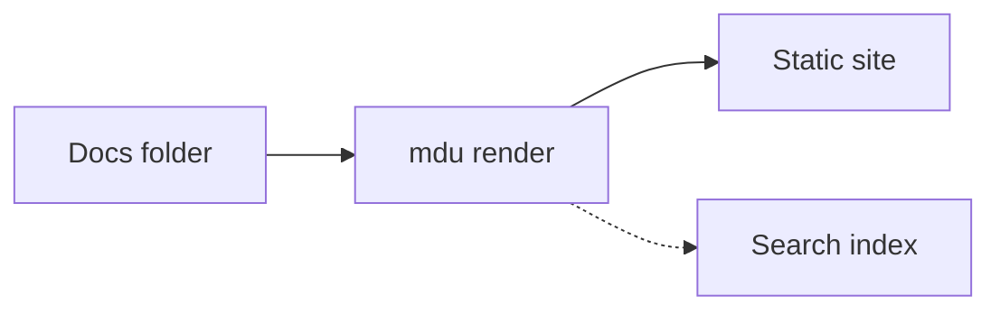
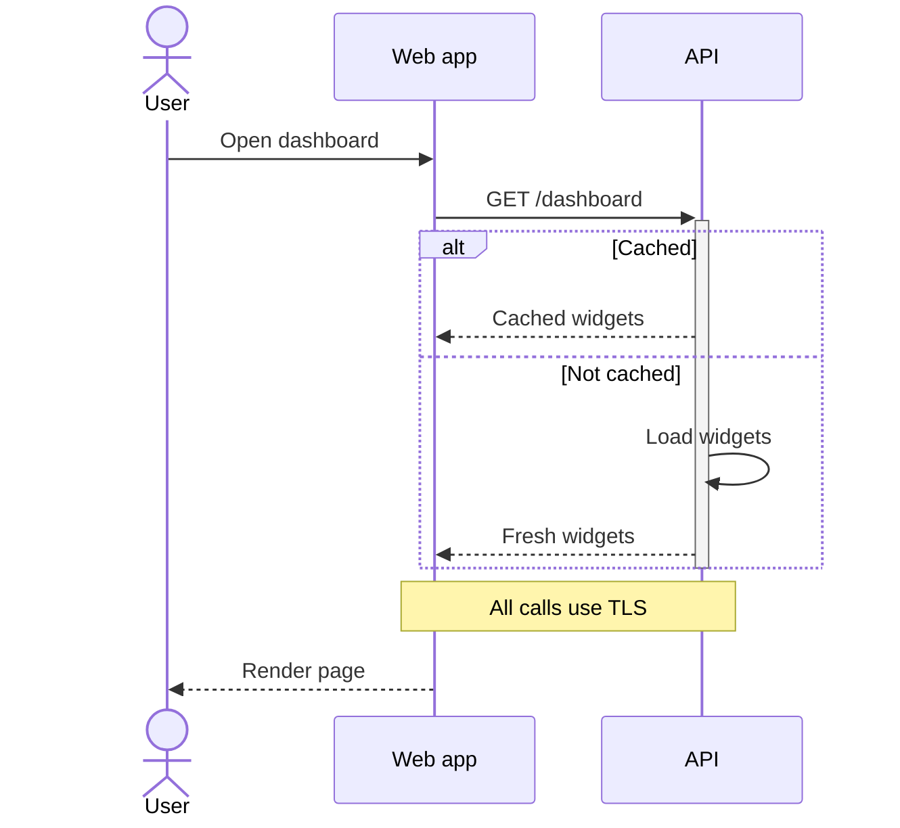

# Diagrams

## Overview

MarkdownUtil renders Mermaid flowcharts and sequence diagrams to static SVG while it renders your Markdown. The diagrams need no JavaScript, appear immediately, and follow the page's light or dark theme because their colors come from the stylesheet instead of the diagram.

The source stays an ordinary ` ```mermaid ` code block, so the same file still shows its diagrams on GitHub and in other Mermaid-aware tools.

If a diagram uses syntax outside the supported subset, such as `subgraph` or other diagram types, MarkdownUtil shows its source as a code block instead.

## Flowcharts

~~~markdown

~~~


Use `LR` for a diagram that flows from left to right:



### Supported flowchart syntax

| Element | Syntax |
| --- | --- |
| Header | `flowchart` or `graph`, optionally followed by `TD`, `TB`, `BT`, `LR`, or `RL` |
| Rectangle | `A[Text]` |
| Rounded rectangle | `A(Text)` |
| Stadium | `A([Text])` |
| Circle | `A((Text))` |
| Decision | `A{Text}` |
| Links | `-->`, `---`, `-.->`, `-.-`, `==>`, `===` |
| Link ends | `<-->`, `--o`, `--x` |
| Link labels | `A -- Text --> B`, or the text between two pipes after the link (see below) |
| Longer links | Add dashes, dots, or equal signs, for example `--->` |
| Chains and groups | `A --> B --> C`, `A & B --> C` |
| Line breaks | `<br>` inside a label |
| Comments | Lines starting with `%%` |

Write a link label between pipes directly after the link, for example `A -->|Text| B`. Quote labels that contain brackets: `A["Text (with brackets)"]`.

Styling statements such as `style`, `classDef`, `class`, and `linkStyle` are ignored, because the page theme defines the colors. `accTitle: Text` sets the accessible name of the diagram.

## Sequence diagrams

~~~markdown

~~~


### Supported sequence diagram syntax

| Element | Syntax |
| --- | --- |
| Header | `sequenceDiagram` |
| Participants | `participant A`, `participant A as Label`, `actor A as Label` |
| Messages | `->`, `-->`, `->>`, `-->>`, `-x`, `--x`, `-)`, `--)`, `<<->>`, `<<-->>`, each followed by `: Text` |
| Activations | `activate A`, `deactivate A`, or `+` and `-` after the arrow, for example `A->>+B: Text` |
| Notes | `Note left of A: Text`, `Note right of A: Text`, `Note over A: Text`, `Note over A,B: Text` |
| Blocks | `loop`, `alt` with `else`, `opt`, `par` with `and`, `critical` with `option`, `break`, each closed with `end` |
| Highlighted areas | `rect` … `end`; the color argument is ignored |
| Numbering | `autonumber`, `autonumber 10 5` (start and step), `autonumber off` |
| Titles | `title Text`, `accTitle: Text` |
| Line breaks | `<br>` inside a label, message, or note |
| Comments | Lines starting with `%%` |

Participants appear in the order they are declared or first used. `box`, `create`, `destroy`, and participant links are not supported yet.
