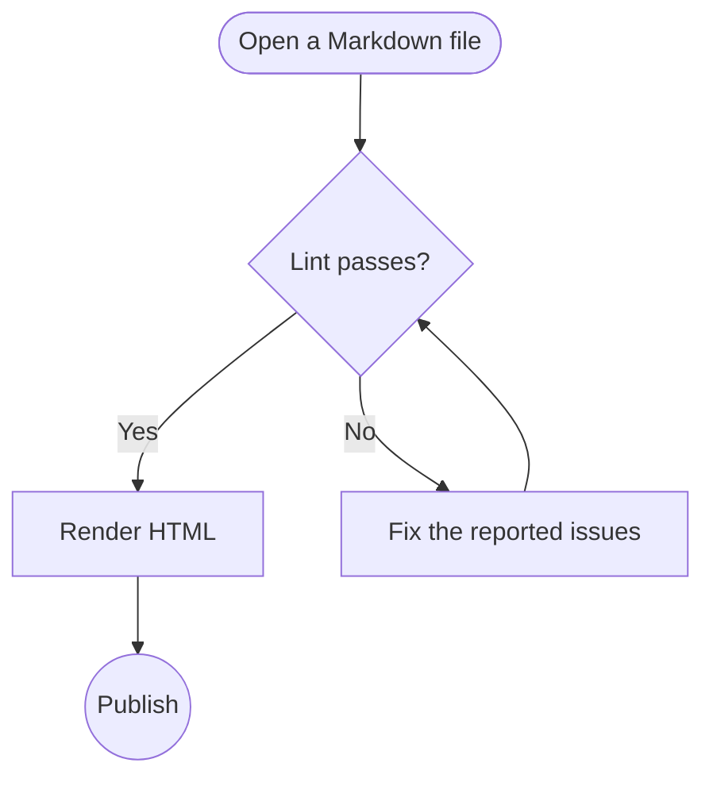
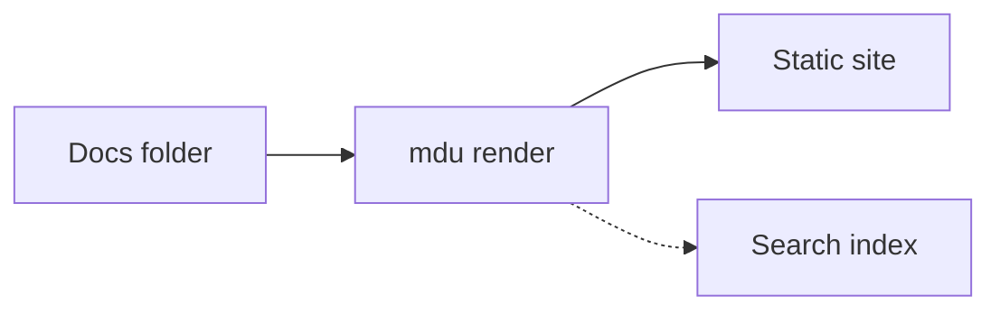
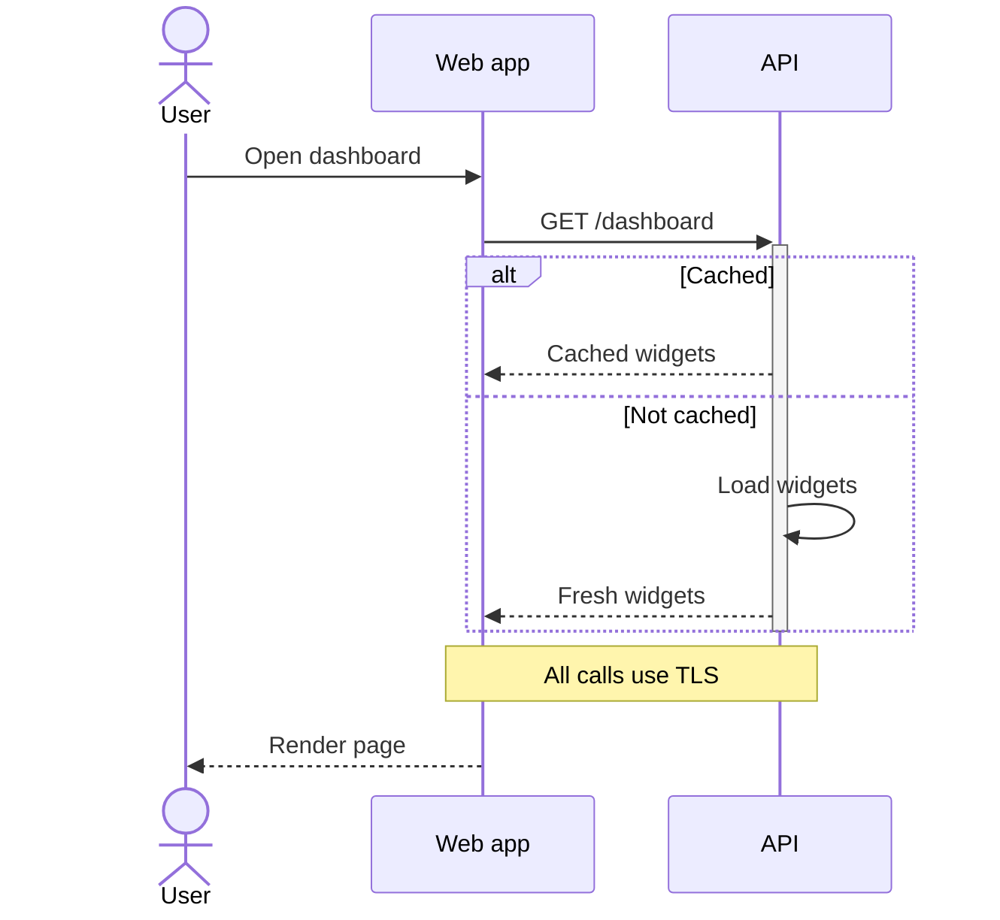
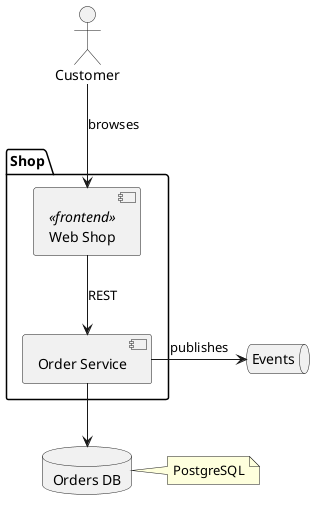

# Diagrams

## Overview

MarkdownUtil renders Mermaid flowcharts and sequence diagrams, PlantUML component diagrams, and its own context diagrams to static SVG while it renders your Markdown. The diagrams need no JavaScript, appear immediately, and follow the page's light or dark theme because their colors come from the stylesheet instead of the diagram.

Mermaid diagrams stay ordinary ` ```mermaid ` code blocks, so the same file still shows them on GitHub and in other Mermaid-aware tools. PlantUML diagrams use ` ```plantuml ` code blocks, which PlantUML-aware tools render as well. Context diagrams use a ` ```context ` code block, which other tools show as plain text.

If a diagram uses syntax outside the supported subset, such as `subgraph` or other diagram types, MarkdownUtil shows its source as a code block instead.

## Flowcharts

~~~markdown

~~~


Use `LR` for a diagram that flows from left to right:



### Supported flowchart syntax

| Element | Syntax |
| --- | --- |
| Header | `flowchart` or `graph`, optionally followed by `TD`, `TB`, `BT`, `LR`, or `RL` |
| Rectangle | `A[Text]` |
| Rounded rectangle | `A(Text)` |
| Stadium | `A([Text])` |
| Circle | `A((Text))` |
| Decision | `A{Text}` |
| Links | `-->`, `---`, `-.->`, `-.-`, `==>`, `===` |
| Link ends | `<-->`, `--o`, `--x` |
| Link labels | `A -- Text --> B`, or the text between two pipes after the link (see below) |
| Longer links | Add dashes, dots, or equal signs, for example `--->` |
| Chains and groups | `A --> B --> C`, `A & B --> C` |
| Line breaks | `<br>` inside a label |
| Comments | Lines starting with `%%` |

Write a link label between pipes directly after the link, for example `A -->|Text| B`. Quote labels that contain brackets: `A["Text (with brackets)"]`.

Styling statements such as `style`, `classDef`, `class`, and `linkStyle` are ignored, because the page theme defines the colors. `accTitle: Text` sets the accessible name of the diagram.

## Sequence diagrams

~~~markdown

~~~


### Supported sequence diagram syntax

| Element | Syntax |
| --- | --- |
| Header | `sequenceDiagram` |
| Participants | `participant A`, `participant A as Label`, `actor A as Label` |
| Messages | `->`, `-->`, `->>`, `-->>`, `-x`, `--x`, `-)`, `--)`, `<<->>`, `<<-->>`, each followed by `: Text` |
| Activations | `activate A`, `deactivate A`, or `+` and `-` after the arrow, for example `A->>+B: Text` |
| Notes | `Note left of A: Text`, `Note right of A: Text`, `Note over A: Text`, `Note over A,B: Text` |
| Blocks | `loop`, `alt` with `else`, `opt`, `par` with `and`, `critical` with `option`, `break`, each closed with `end` |
| Highlighted areas | `rect` … `end`; the color argument is ignored |
| Numbering | `autonumber`, `autonumber 10 5` (start and step), `autonumber off` |
| Titles | `title Text`, `accTitle: Text` |
| Line breaks | `<br>` inside a label, message, or note |
| Comments | Lines starting with `%%` |

Participants appear in the order they are declared or first used. `box`, `create`, `destroy`, and participant links are not supported yet.

## PlantUML component diagrams

~~~markdown

~~~


### Supported PlantUML syntax

MarkdownUtil follows PlantUML's component diagram syntax, so the same source works with PlantUML itself:

| Element | Syntax |
| --- | --- |
| Frame | `@startuml` and `@enduml` are optional |
| Components | `[Name]`, `[Name] as Alias`, `component Name`, `component "Name" as Alias`, `component Alias as "Name"` |
| Interfaces | `() "Name"`, `() "Name" as Alias`, `interface Name`; an unknown name in a link also becomes an interface |
| Other elements | `actor`, `database`, `node`, `cloud`, `folder`, `frame`, `package`, `rectangle`, `card`, `artifact`, `file`, `queue`, `storage` |
| Containers | Any of `package`, `node`, `folder`, `frame`, `cloud`, `database`, `rectangle`, or `component` followed by `{` … `}`, also nested and without a name |
| Stereotypes | `<<name>>` after the element |
| Links | `--` solid, `..` dotted, `==` bold, with `>` or `<` for arrow ends, for example `-->` or `<..`; triangle ends are described below |
| Link direction | `->` keeps both elements in one row, `-->` puts the target below, more dashes make the link longer; `-up->`, `-down->`, `-left->`, `-right->` (also `-u->` and so on) |
| Link styles | `-[hidden]->` only affects the layout, `-[dashed]->`, `-[bold]->` |
| Link labels | `A --> B : Text` |
| Notes | `note left of A : Text`, `note right of`, `note top of`, `note bottom of`, multi-line notes ending with `end note`, `note "Text" as N` |
| Layout | `left to right direction`, `top to bottom direction` |
| Text | `title Text`, `\n` for a line break |
| Comments | Lines starting with `'` and `/'` … `'/` blocks |

A triangle end, as for realization or generalization, is written `..|>` or `<|--`.

`skinparam`, `hide`, `show`, and colors are ignored, because the page theme defines the look. Other PlantUML diagram types, such as sequence or class diagrams, stay code blocks.

## Context diagrams

A context diagram shows one system in the center and the people and systems it works with around it.

> [!NOTE]
> Context diagrams are a MarkdownUtil extension. Neither Mermaid nor PlantUML has this diagram type, so only `mdu` renders them. GitHub and other tools show the ` ```context ` block as plain code.

A context diagram uses the flowchart syntax for systems and links, and `actor` for people:

~~~markdown
```context
MC[Mobile Capture]
MC <--> IdP[Zuvex<br>IdP]
MC <--> DRiVe[DRiVe<br>Verfahren]
MC --> DB[Datenbank]
MC --> Mail[Dataport<br>E-Mail Server]
MC --> AD[Active<br>Directory]
actor LK as Lehrkräfte
actor SL as Schulleitung
LK -. Verwendet .-> MC
SL -.-> MC
```
~~~

```context
MC[Mobile Capture]
MC <--> IdP[Zuvex<br>IdP]
MC <--> DRiVe[DRiVe<br>Verfahren]
MC --> DB[Datenbank]
MC --> Mail[Dataport<br>E-Mail Server]
MC --> AD[Active<br>Directory]
actor LK as Lehrkräfte
actor SL as Schulleitung
LK -. Verwendet .-> MC
SL -.-> MC
```

### Supported context diagram syntax

| Element | Syntax |
| --- | --- |
| Systems | The flowchart shapes, for example `A[Text]`, `A(Text)`, `A([Text])`, `A((Text))`, `A{Text}` |
| People | `actor A` or `actor A as Label` |
| Links | The flowchart links, link ends, and labels, for example `-->`, `<-->`, `-.->`, `==>`, and `A -- Text --> B` |
| Titles | `accTitle: Text` |
| Comments | Lines starting with `%%` |

The system in the center is the one that every link connects to. If several systems qualify, for example with a single link, the first one in the source is used. All other systems and people are spread evenly around the center, clockwise from the top in the order they first appear, so you control the arrangement by reordering the lines. A context diagram needs no header line.
