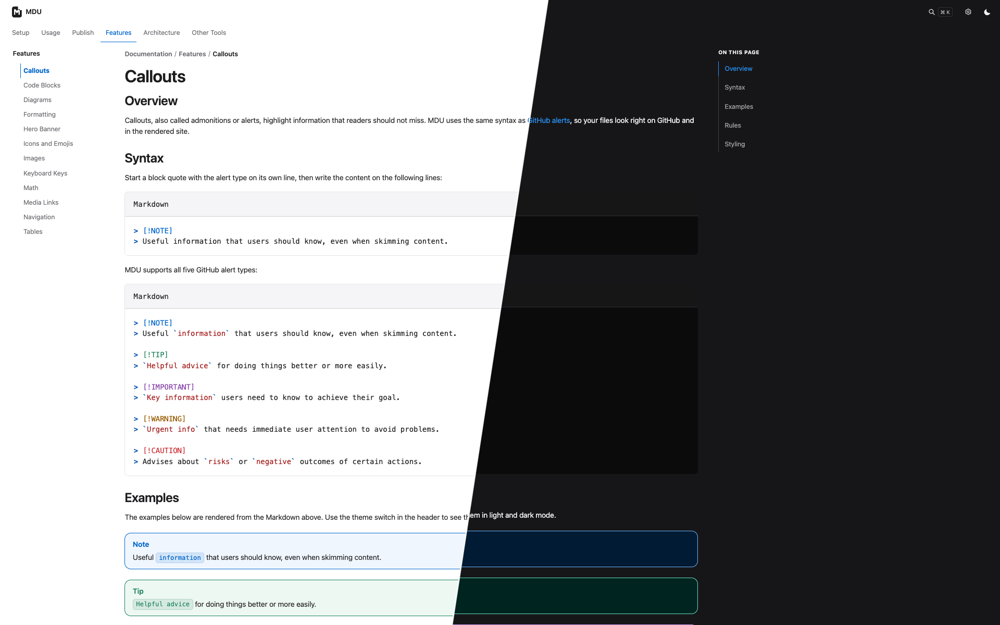

<p align="center">
  <a href="https://capjan.github.io/mdu/">
    <picture>
      <source media="(prefers-color-scheme: dark)" srcset=".github/assets/banner-dark.svg">
      <source media="(prefers-color-scheme: light)" srcset=".github/assets/banner-light.svg">
      
    </picture>
  </a>
</p>

<p align="center">
  <a href="https://github.com/capjan/mdu/actions/workflows/dotnet.yml"></a>
  <a href="https://www.nuget.org/packages/mdu"></a>
  <a href="https://hub.docker.com/r/capjan/mdu"></a>
  <a href="LICENSE"></a>
</p>

<p align="center">
  <a href="https://capjan.github.io/mdu/"><strong>Documentation</strong></a>
  &nbsp;&middot;&nbsp;
  <a href="https://capjan.github.io/mdu/Setup/"><strong>Get started</strong></a>
  &nbsp;&middot;&nbsp;
  <a href="https://capjan.github.io/mdu/Features/"><strong>Features</strong></a>
  &nbsp;&middot;&nbsp;
  <a href="https://capjan.github.io/mdu/Usage/"><strong>Commands</strong></a>
  &nbsp;&middot;&nbsp;
  <a href="https://github.com/capjan/mdu/releases"><strong>Releases</strong></a>
</p>

<br>

<p align="center">
  Turn a folder of plain Markdown into a fast, searchable documentation site.<br>
  One .NET tool. Zero configuration. No Node.js or Python toolchain.
</p>

<p align="center">
  <a href="https://capjan.github.io/mdu/">
    
  </a>
  <br>
  <sub>
    The <a href="https://capjan.github.io/mdu/">MDU documentation</a>, rendered by MDU itself.
  </sub>
</p>

<br>

## Quick start

```bash
dotnet tool install -g mdu   # install
mdu serve                    # live preview of ./docs
mdu render                   # build the site into ./site
```

Prefer a standalone executable or Docker? See the [installation guide](https://capjan.github.io/mdu/Setup/).

## Explore the documentation

<table>
  <tr>
    <td width="33%" valign="top">
      <a href="https://capjan.github.io/mdu/Setup/"><strong>Setup&nbsp;→</strong></a><br>
      <sub>Install MDU as a .NET tool, standalone executable, or Docker image.</sub>
    </td>
    <td width="33%" valign="top">
      <a href="https://capjan.github.io/mdu/Usage/"><strong>Commands&nbsp;→</strong></a><br>
      <sub>Preview, lint, render, and export your docs to PDF.</sub>
    </td>
    <td width="33%" valign="top">
      <a href="https://capjan.github.io/mdu/Features/"><strong>Features&nbsp;→</strong></a><br>
      <sub>Callouts, diagrams, OpenAPI, math, icons, and code highlighting.</sub>
    </td>
  </tr>
  <tr>
    <td width="33%" valign="top">
      <a href="https://capjan.github.io/mdu/Features/Navigation.html"><strong>Navigation&nbsp;→</strong></a><br>
      <sub>Tabs, sidebar, and breadcrumbs built from your folder structure.</sub>
    </td>
    <td width="33%" valign="top">
      <a href="https://capjan.github.io/mdu/Publish/"><strong>Publish&nbsp;→</strong></a><br>
      <sub>Host the site on GitHub Pages, GitLab Pages, or any web server.</sub>
    </td>
    <td width="33%" valign="top">
      <a href="https://capjan.github.io/mdu/Architecture/"><strong>Architecture&nbsp;→</strong></a><br>
      <sub>How MDU parses, validates, and renders your documentation.</sub>
    </td>
  </tr>
</table>

<br>

<p align="center">
  <sub>
    Released under the <a href="LICENSE">MIT License</a>.
  </sub>
</p>
